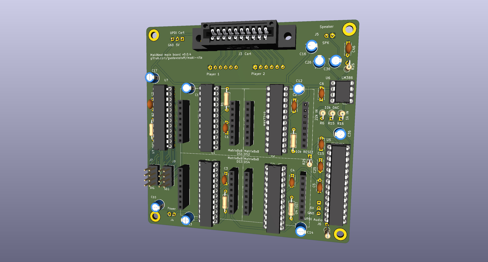
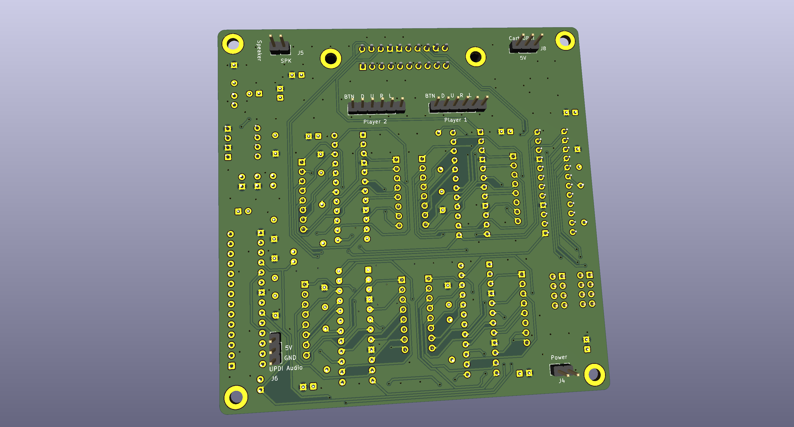
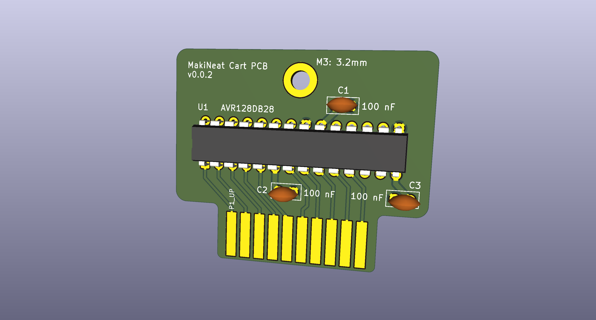
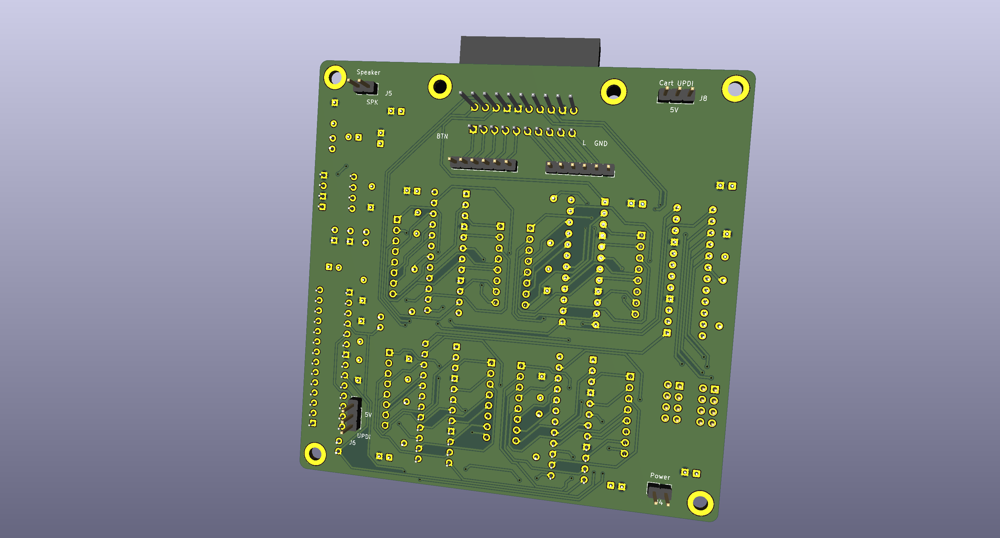
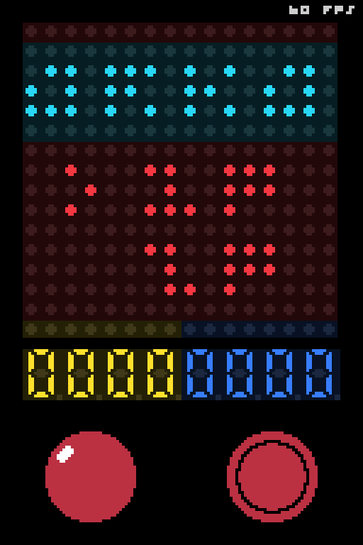

MakiNeat is a cartridge-based, two-player portable tabletop Arcade. The name comes from _maquinita_, a Mexican word generally used for an arcade machine (pronounced very similarly). The display is four 8x8 LED matrices in a 16x16 field. Graphics are 1-bit (LEDs are either ON or OFF).

On a similar spirit as the Magnavox Odyssey and the Vectrex, MakiNeat uses colored, translucent sheets to cover the screen. So the overlay is an extension of the cartridge, part of the game experience. The cabinet uses a top-loader cart door and a magnetic marquee panel mounts near the top as well. The [overlays](docs/overlays.md) and [design](docs/design.md) docs cover the sheet and the system netlist.

An AVR128DB28 on a cartridge runs the game and holds the picture (the cartridge is both the system brain and the game data). Four MAX7219 drivers refresh the screen grid.

## Goals

Simple graphics + simple input can still be fun. A stick (and sometimes a button) is all that's needed. Together with cartridges, colored overlays, and a sturdy design, that is the spirit of MakiNeat.

- The build is DIY friendly and straight forward.
- Parts are mostly through-hole, on a 2.54 mm grid.
- Parts are cheap, the main system board is a two-layer 100x100 mm board (~5 USD + shipping).
- The cartridge is an even smaller PCB.
- The screen is four white 8x8 LED matrices (normally less than 1 USD each).
- Chips and LED matrices can sit in sockets.
- Power is any generic/regulated 5 V adapter.

Software is under the MIT License. The hardware design is under the CERN Open Hardware Licence Version 2, Strongly Reciprocal.

## PCBs

Copper tracing is mostly done but not polished (EMI, test points, noise, etc). The full [SKiDL netlist](tools/kicad/main-pcb/skidl/makineat.py) and KiCad files are already under `tools/kicad/main-pcb/` and `tools/kicad/cart-pcb/` (not tested IRL).

Main system PCB, 100x100 mm:

Cartridge PCB, 44x37 mm:

## Game simulator

`tools/sim` is a netlist simulation of the system. The simulator compiles the cartridge's C game code natively on the host to drive the hardware model. This same C code can be directly flashed to the AVR on the cartridge.

SKiDL export writes `tools/kicad/main-pcb/skidl/makineat.net` and updates net classes in the main-board `*.kicad_pro` files. See [design](docs/design.md) and [firmware](docs/firmware.md).

`./sim.sh` opens the UI. The active cart is named in `cart_placed.json`.

## Screen overlay

Physical translucent sheets, placed in front of the white matrix LEDs and status digits, make multi-colored graphics.

## Docs

- [Design](docs/design.md) is the system netlist, cart edge, display chain, audio wiring, and PCB layout status.
- [Firmware](docs/firmware.md) is the game loop, inputs, sound, SDK, and simulator.
- [PCB routing considerations](docs/pcb-considerations.md) is noise isolation and trace pairing rules for the main and cart layouts.
- [Overlays](docs/overlays.md) is the colored sheet in front of the field.
- [Future plans](docs/future-plans.md) is the hardware and firmware enhancement roadmap.
- [Status digits](docs/status-digits.md) is the fifth MAX7219 driver, J7/J9 interfaces, and the planned digit daughterboard.
- [Driver to matrix pinout](docs/driver_to_matrix_pinout.md) is the MAX7219 and 1088AS LED matrix pinout and activation reference.

