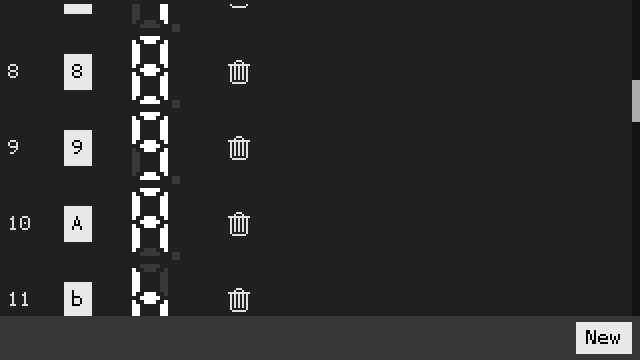
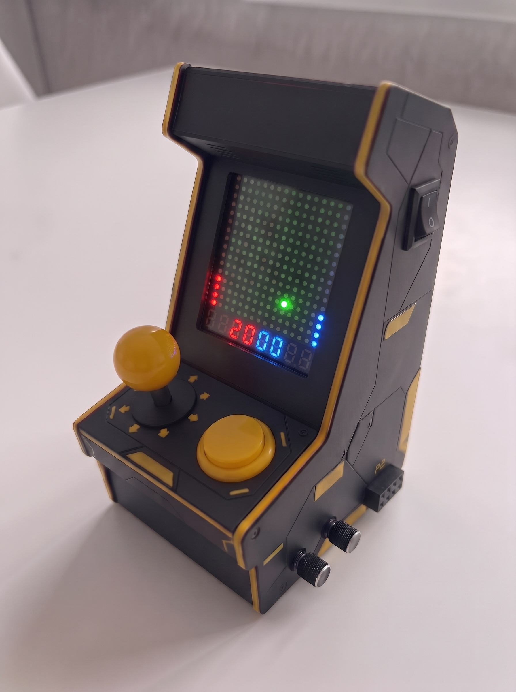

MakiNeat is a cartridge-based portable arcade tabletop. The name comes from _maquinita_, a Mexican word for arcade machines (pronounced very similarly). The display is four 8x8 LED matrices in a 16x16 field, plus eight 7-segment digits displays. Graphics are 1-bit (LEDs are either ON or OFF).

On a similar spirit as the Magnavox Odyssey and the Vectrex, MakiNeat uses colored, translucent sheets to cover the screen. So the overlay is an extension of the cartridge, part of the game experience. Read [overlays](docs/overlays.md) and [design](docs/design.md) for details.

An AVR128DB28 on a cartridge runs the game and holds the picture (the cartridge is both the system brain and the game data). Five MAX7219 drivers share one SPI chain. Four refresh the screen grid. The fifth drives the 7-segment status digits.

Simple graphics + simple input can still be fun. A stick (and sometimes a button) is all that's needed. Together with cartridges, colored overlays, and a sturdy design, that is the spirit of MakiNeat.

## PCBs

Copper tracing is mostly done but not polished. The full [SKiDL netlist](tools/kicad/main-pcb/skidl/makineat.py) and KiCad files are under `tools/kicad/main-pcb/` and `tools/kicad/cart-pcb/` (not tested IRL).

Main system PCB, 100x100 mm:

Cartridge PCB, 44x37 mm:

## Game simulator

`tools/sim` is a netlist simulation of the system. The simulator compiles the cartridge's C game code natively on the host to drive the hardware model. This same C code can be directly flashed to the AVR on the cartridge. Acetate overlays can be built in real time and are saved per game.

SKiDL export writes `tools/kicad/main-pcb/skidl/makineat.net` and updates net classes in the main-board `*.kicad_pro` files. See [design](docs/design.md) and [firmware](docs/firmware.md).

`./sim.sh` opens the UI. The active cart is named in `cart_placed.json`. Game SDK tiers (frame, map, entity, collide) are documented in [firmware](docs/firmware.md).

## 7-segment font

`tools/seven-seg-font` edits the shared 7-segment font. Each row is a symbol and the segments that light for it. Games use that table when they draw their own digits, such as the Pong title screen. Closing the editor writes `tools/fw/seven_seg_font.c`.

`./seven-seg-editor.sh` opens the editor.

## Design

The image below is an **AI-generated** concept idea of how the build _might_ look when assembled. It's currently only being used as a reference.

## Docs

- [Design](docs/design.md) is the system netlist, cart edge, display chain, audio wiring, and PCB layout status.
- [Firmware](docs/firmware.md) is the game loop, inputs, sound, SDK, and simulator.
- [PCB routing considerations](docs/pcb-considerations.md) is noise isolation, ground via stitching, and trace pairing rules for the main and cart layouts.
- [Test points and status LEDs](docs/test-points-and-status-leds.md) is the planned main-board bring-up pads and indicator colors (not on PCB yet).
- [Overlays](docs/overlays.md) covers physical sheets, simulator tinting, and edit controls.
- [Future plans](docs/future-plans.md) is the hardware and firmware enhancement roadmap.
- [Status digits](docs/status-digits.md) is the fifth MAX7219 driver, J7/J9 interfaces, and the planned digit daughterboard.
- [Driver to matrix pinout](docs/driver_to_matrix_pinout.md) is the MAX7219 and 1088AW LED matrix pinout and activation reference.

